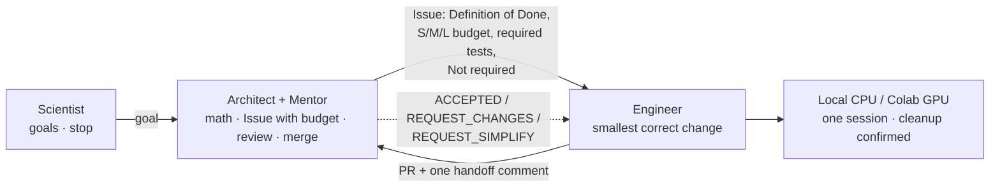

# SAE Framework

> English (normative) | [简体中文](README.zh-CN.md)

**Scientist–Architect–Engineer** is a GitHub-first way for one human and a few AI agents to build mathematical / PyTorch scientific software together. It has two equal goals: **correct, reproducible software at low cost**, and **the Scientist's deeper understanding** of the mathematics, numerics and hardware behind it.

**Current version: V3.4.** Its core rule is the [Simplicity Contract](governance/SIMPLICITY_CONTRACT.md): *the smallest change that meets the Definition of Done is the correct change.*

## Roles

| Role | Who (default) | Does | Never |
|---|---|---|---|
| **Scientist** | you (human) | Sets goals, redirects or stops work | Routine approvals of science, compute or merges |
| **Architect + Mentor** | Claude | Mathematics, specs, dispatch with a size budget, evidence review, merges | Writes production code it then certifies itself |
| **Engineer** | Codex (or Claude Code) | Implements, tests, runs CPU/GPU experiments, opens PRs | Approves or merges its own work |

Roles are contracts, not products: any capable agent can fill one. Trigger commands: `推进架构师工作` · `推进导师工作` · `推进工程师工作`.

The card diagram shows the role layout; its agent names (e.g. GPT) are examples only, and any capable agent can fill a role. Editable source: [.mmd](docs/figures/SAE_Framework_V3.3.en.mmd).

## How work flows
1. **Architect** writes one Issue: goal, math contract, Definition of Done, size budget (S ≤ 50 / M ≤ 200 / L ≤ 500 lines), required tests, *Not required* list.
2. **Engineer** makes the smallest correct change, runs the required tests (and GPU runs if asked), opens one PR with one handoff comment.
3. **Architect** reviews size first, then correctness. The outcome is `ACCEPTED`, `REQUEST_CHANGES` or `REQUEST_SIMPLIFY`. Eligible PRs are merged under [Standing Authorization](governance/STANDING_AUTHORIZATION.md).

GitHub Issues and PRs are the only shared record. No GitHub Actions; compute runs on the Engineer's machine and existing Colab entitlements.

## Repository map

| Path | What it is |
|---|---|
| [AGENTS.md](AGENTS.md) | Constitution every agent reads first |
| [governance/](governance/) | [Simplicity Contract](governance/SIMPLICITY_CONTRACT.md) · [Standing Authorization](governance/STANDING_AUTHORIZATION.md) (merge scope, security, spending) |
| [protocols/](protocols/) | One page per role: [Scientist](protocols/SCIENTIST.md) · [Architect](protocols/ARCHITECT.md) · [Mentor](protocols/MENTOR.md) · [Engineer](protocols/ENGINEER.md) |
| [workflows/](workflows/) | [Start](workflows/START.md) (new session, adoption) · [Tasks](workflows/TASKS.md) (Issues, PRs, review) · [Research](workflows/RESEARCH.md) (math, reuse, learning) · [Compute](workflows/COMPUTE.md) (CPU/GPU runs) |
| [templates/](templates/) | Issue, PR, research note and run summary |
| [tools/compute/](tools/compute/README.md) | Colab controller: one bounded GPU session, observed device, guaranteed cleanup |
| [docs/figures/](docs/figures/) | Architecture diagrams (SVG + Mermaid source) |
| [examples/](examples/) | Project `AGENTS.md`, `sae.yaml`, `.sae/README.md` and a compute adapter |

## Start
- **New session:** see [Start](workflows/START.md). It has copy-ready prompts for the Architect and Engineer windows.
- **New project:** copy the files in [examples/project](examples/project/), pin an exact SAE commit SHA, and open a PR ([Start § Adopt](workflows/START.md#adopt-sae-in-a-project)).
- **Existing projects** keep their pinned SAE commit until they bump it explicitly.

## Status
- **Verified:** Colab controller on real T4, L4, A100 and G4 (RTX PRO 6000) with observed device identity and authenticated-zero cleanup ([#67](https://github.com/JohnnyZPiggy/SAE-Framework/pull/67), [#69](https://github.com/JohnnyZPiggy/SAE-Framework/pull/69), [#73](https://github.com/JohnnyZPiggy/SAE-Framework/pull/73)). First project: [TorchOED](https://github.com/JohnnyZPiggy/TorchOED).
- **Not implemented:** TPU / PyTorch-XLA runs, automatic project bootstrap, any background scheduler.

[Changelog](CHANGELOG.md) · [MIT License](LICENSE) © 2026 JohnnyZPiggy
