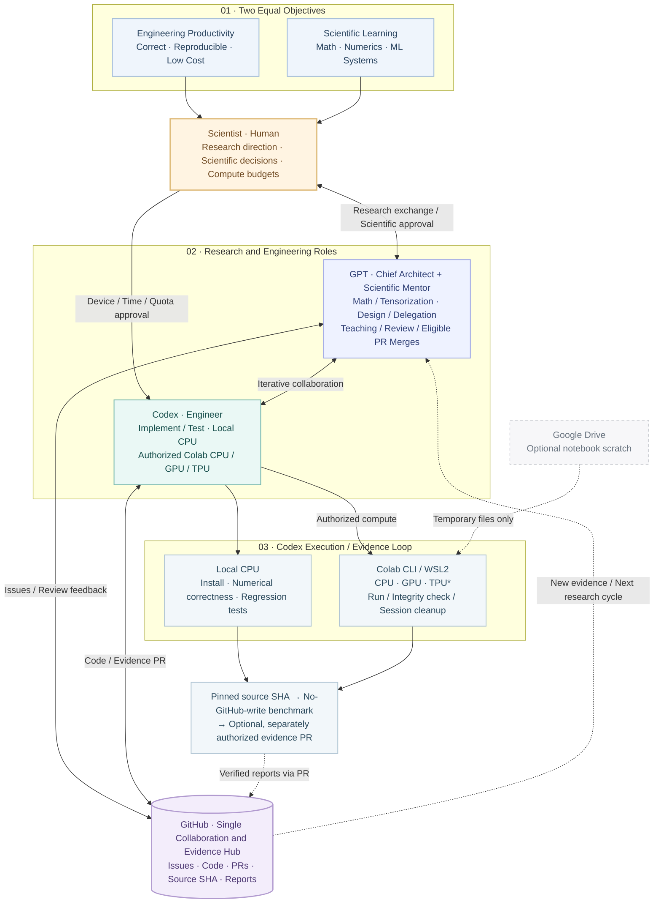

# SAE Framework V3.3

> English normative | [简体中文](README.zh-CN.md)

**Scientist–Architect–Engineer** is a GitHub-first collaboration framework for mathematical algorithms, PyTorch scientific computing and ML engineering. It pursues **two equal goals**: reliable low-cost engineering and the Scientist's deeper mathematical/numerical/ML-systems learning.

[Editable Mermaid source (.mmd)](docs/figures/SAE_Framework_V3.3.en.mmd)

Editable Mermaid architecture diagram

The SVG is the high-resolution overview. The editable Mermaid source below is rendered natively by GitHub; both represent the V3.3 role and compute boundaries.

*TPU/PyTorch-XLA and automated report publication remain unverified.*

## Who does what?
- **Scientist (human):** selects research problems, approves mathematical/scientific conclusions and compute hardware/session/time/quota limits; no routine notebook operation.
- **GPT Architect:** designs specifications and experiments, delegates via Issues, reviews evidence and independently decides eligible PR merges under [Standing Authorization](governance/STANDING_AUTHORIZATION.md).
- **GPT Mentor:** leads mathematical structure/tensorization research and explains numerical/experimental results.
- **Codex Engineer:** implements, tests and runs authorized local CPU and Colab CLI CPU/GPU/TPU experiments; verifies downloads and resource cleanup; submits evidence through GitHub branches/PRs without self-merging.

**GitHub** is the collaboration and evidence hub. **Colab CLI** supplies remote compute. **Drive** is an optional thin notebook workspace, not a sync/results transport.

## Workflow
Scientist-reviewed [mathematical study](workflows/MATHEMATICAL_RESEARCH.md) → Architect [Build-vs-Reuse](workflows/ECOSYSTEM_REVIEW.md) and engineering Issue → Codex implementation, numerical tests and authorized compute → GitHub evidence PR → Architect review/iteration/eligible merge. Multiple rounds can return to research.

Experiments have **three separate stages**: exact source-SHA install, benchmark **without GitHub writes**, and optional separately authorized safe report publication. See [Compute Experiment Protocol](workflows/GPU_EXPERIMENT.md); the [historically named compatibility file](workflows/COLAB_TWO_COMMAND.md) remains linked.

## Start
Read [AGENTS.md](AGENTS.md), then [Bootstrap V3.3](SAE_BOOTSTRAP.md). Adopt [project AGENTS](examples/project/AGENTS.md) and [sae.yaml](examples/project/sae.yaml) with a **real pinned framework commit SHA**; do not silently upgrade existing projects.

| Role command | Purpose |
| --- | --- |
| `推进导师工作` | Mathematical discovery and scientific learning |
| `推进架构师工作` | Design, delegate, review and decide merges |
| `推进工程师工作` | Implement, execute authorized experiments and submit PR evidence |

These are user-invoked bounded cycles, not a hosted autonomous agent. No default GitHub Actions/paid CI, secrets in reports, fabricated benchmarks or Drive sync.

## Verification status (2026-10-19)
The Scientist reported one successful Codex → WSL2 → Colab CLI T4 GPU smoke test with result integrity verification and zero active sessions after shutdown. **Not yet verified:** Colab CPU, TPU allocation/PyTorch-XLA, automatic GitHub publication, cross-project reuse and a complete SAE benchmark-to-PR workflow. Bootstrap/Publisher automation is not established by documentation alone.

## Documentation
[Architect](protocols/ARCHITECT.md) · [Engineer](protocols/ENGINEER.md) · [Mentor](protocols/MENTOR.md) · [Scientist](protocols/SCIENTIST.md) · [Role Recovery](workflows/ROLE_RECOVERY.md) · [Changelog](CHANGELOG.md) · [Chinese index](i18n/zh-CN/README.md)

**Version:** V3.3 architecture and protocol; existing pinned V3.2 project snapshots remain unchanged until explicitly upgraded. **License:** no repository license selected; public visibility alone is not a reuse grant.
