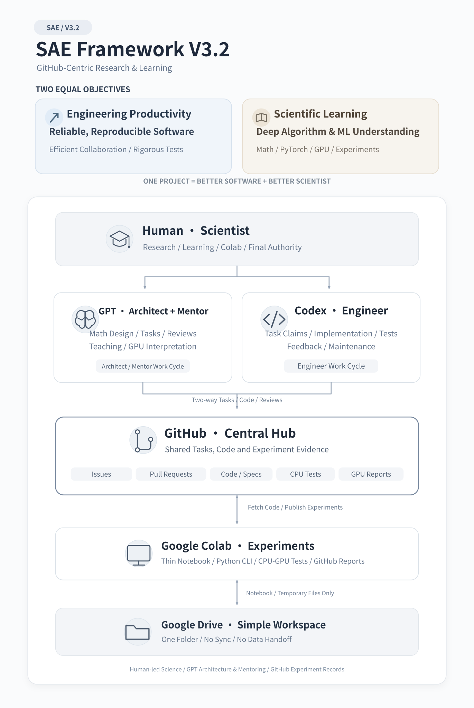

## Integrated operating model

**One role command, two Colab commands, three scientific artifacts.** Follow [research → CPU validation → GPU readiness → GPU experiment](workflows/RESEARCH_PIPELINE.md). The [three-artifact handoff](workflows/THREE_ARTIFACT_HANDOFF.md) links mathematics, engineering and experimental evidence; the [two-command Colab contract](workflows/COLAB_TWO_COMMAND.md) defines a pinned GitHub pip install and a packaged benchmark CLI with optional safe PR publication. These are target interfaces; Bootstrap and Publisher CLIs are not yet implemented.

## Default research pipeline

**Research-First → CPU-Validated → GPU-Finalized.** Day-to-day mathematical and CPU engineering work runs without Colab. Only a reviewed [GPU Readiness Gate](templates/GPU_READINESS.md) permits a Scientist-run GPU experiment. Read the [three-stage protocol](workflows/RESEARCH_PIPELINE.md). CPU `torch.compile` testing is required when supported, but does **not** establish GPU compatibility or speedup.

# SAE Framework V3.2

> Language: **English** | [简体中文](README.zh-CN.md)

**Scientist–Architect–Engineer (SAE)** — a GitHub-first, plug-and-play collaboration framework for mathematical algorithms, PyTorch scientific computing, and ML engineering.

> **One Project, Two Outcomes: Better Software, Better Scientist.**

## Visual Overview

The two equally important objectives—**Engineering Productivity** and **Scientific Learning**—guide every SAE project. The diagram shows how the human Scientist, GPT (Chief Architect + Scientific Mentor), Codex, GitHub, Colab and the optional lightweight Drive workspace fit together.

  

[English SVG](docs/figures/SAE_Framework_V3.2.en.svg) · [中文架构图](docs/figures/SAE_Framework_V3.2.zh-CN.svg) · [View the editable Mermaid architecture](docs/ARCHITECTURE.md)

## Research-first algorithm workflow

**Mathematical structure before implementation:** on every new algorithm or major tensorization redesign, GPT's **Scientific Mentor** first investigates exploitable mathematical operators (especially matrix–vector products, matrix-free linear maps, batching and tensor contractions) and derives a justified PyTorch-friendly tensor formulation. Only after the human Scientist reviews the resulting **[Mathematical Structure & Tensorization Study](workflows/MATHEMATICAL_RESEARCH.md)** does the Chief Architect design engineering tasks and experiments for Codex and Colab.

`Mentor structure discovery → mathematical tensorization → Architect design & experiment plan → Codex CPU engineering → Scientist Colab validation → iterate`

The entry gate guards against premature coding; feedback can always return to research. `RESEARCH_READY` is **not** a claim of benchmarked speedup.

## Two parallel objectives

| Engineering Productivity | Scientific Learning |
| --- | --- |
| Build reliable, modular, reproducible algorithm packages with low cost and minimal coordination overhead. | Learn mathematical algorithms, numerical methods, PyTorch, GPU experimentation, and ML engineering through real projects. |

Neither objective is optional: a successful iteration records both **engineering evidence** and **learning opportunities/outcomes**.

## Roles

| Participant | Responsibility |
| --- | --- |
| **Human Scientist** | Selects problems, makes scientific decisions, prepares and runs Google Colab experiments, evaluates results, and retains final authority. |
| **GPT — Chief Architect** | Formalizes mathematics, specifies algorithms and interfaces, creates/triages GitHub tasks, reviews engineering and experiment evidence, accepts and merges changes when authorized. |
| **GPT — Scientific Mentor** | Teaches the mathematics, algorithms, numerical issues, PyTorch principles, and GPU experiment interpretation; supports independent understanding. |
| **Codex — Software Engineer** | Claims ready GitHub tasks; implements modular Python/CLI, runs real CPU tests and benchmarks, maintains code, opens PRs, and provides evidence. |
| **GitHub** | Shared durable hub for specifications, Issues, PRs, decisions, source code, and compact GPU experiment reports. |
| **Colab + minimal Drive folder** | Human-operated CPU/GPU runtime; the Drive folder only stores notebook/workspace materials, **not** a synchronization or results-exchange layer. |

## Start here

1. Read [SAE_BOOTSTRAP.md](SAE_BOOTSTRAP.md) to initialize a **new or existing project** safely.
2. Read [AGENTS.md](AGENTS.md) for shared rules.
3. Read the relevant role file in [protocols/](protocols/) and workflows in [workflows/](workflows/).
4. Adopt [examples/project/AGENTS.md](examples/project/AGENTS.md) and [examples/project/sae.yaml](examples/project/sae.yaml) in each new project, then import a **pinned** copy of the protocols under `.sae/`.
5. Connect each AI to the **project's** GitHub repository. A URL in instructions does not itself grant access or cause files to be read.

## Operating commands

| Command (Chinese) | Role | A single cycle does... |
| --- | --- | --- |
| **推进架构师工作** | GPT / Architect | Inspect project state → specify/dispatch → review code and Colab evidence → accept/merge when authorized → report next actions |
| **推进工程师工作** | Codex / Engineer | Claim ready Issue → implement → test → document → open/update PR → report blockers |
| **推进导师工作** | GPT / Mentor | **Before engineering:** discover matrix-vector/tensor structure → derive tensorization → deliver mathematical research study; **afterward:** teach and interpret experiments |

Commands are **conventions defined by the role protocols**, not autonomous background agents or guaranteed built-in software features. Each command runs only with actual tool access and the user's invocation.

## Operating rules

- **GitHub-first:** Issues are the task queue; PRs are proposed changes and reviews; small, reproducible experiment summaries return to GitHub.
- **No GitHub Actions / no paid CI requirement.** Codex runs CPU tests in its available environment; the Scientist runs GPU tests in Colab. No CI results should be invented.
- **Thin Notebooks:** GPT authors orchestration notebooks; Codex owns reusable Python modules, tests, benchmarks, experiment CLI, and publisher implementation.
- **Evidence before claims:** record the tested source commit SHA, environment, commands, seeds, correctness metrics, timing methodology, and raw-data pointers. Do not claim unexecuted tests passed.
- **Separate review from execution:** no silent force-pushes, secret commits, unreviewed merges, or destructive changes.
- **No Drive sync:** only a small local-to-Colab workspace folder if useful; not a cross-agent transport.
- **Learning is a first-class output:** a learning note is linked to meaningful milestones without turning education into bureaucratic busywork.

## Documentation languages

- **English:** this README and the original protocol documents are canonical for agents.
- **简体中文:** [中文首页](README.zh-CN.md) and [Chinese documentation index](i18n/zh-CN/README.md).
- [Language policy / 翻译规范](docs/LANGUAGE_POLICY.md) explains how both versions stay aligned.

## File map

- [SAE_BOOTSTRAP.md](SAE_BOOTSTRAP.md) — safe initialization procedure
- [docs/ADOPTION_SMOKE_TEST.md](docs/ADOPTION_SMOKE_TEST.md) — verify imported links, pinned snapshots and role handoffs in a real target project
- [AGENTS.md](AGENTS.md) — common constitution
- [protocols/](protocols/) — role-specific instructions
- [workflows/](workflows/) — tasks, review, experiments, learning, safety
- [templates/](templates/) — ready-to-use Issue, PR, report and project snippets
- [examples/](examples/) — minimal adopting-project configuration
- [docs/ARCHITECTURE.md](docs/ARCHITECTURE.md) — decisions, interfaces, and boundaries

## Deployment status

This repository contains the **instructions, configuration examples, and templates** to bootstrap SAE. It is not itself a hosted agent runner. Real GitHub writes require an authorized connector or CLI; GPU result publishing requires a separate implemented/tested publisher (see [workflows/GPU_EXPERIMENT.md](workflows/GPU_EXPERIMENT.md)). Until that exists, upload or commit reports manually.

## Versioning

Framework architecture: **V3.2**. Pin an actual immutable **Git commit SHA or release tag** when importing it into a project. Update only through reviewed changes. See [CHANGELOG.md](CHANGELOG.md).

## License

No license is selected yet. Public visibility **does not** imply permission to reuse or redistribute. The repository owner should choose a license before publishing this as a reusable software template.

## Mobile-first next-step commands

After each substantive GPT Mentor / Architect / Codex cycle, the agent must recommend **one specific next command**, with at most two alternatives, verified GitHub evidence and any Scientist approval required. See [Next-Action Protocol](workflows/NEXT_ACTION.md). The text command works across clients; optional interactive actions only where supported.
