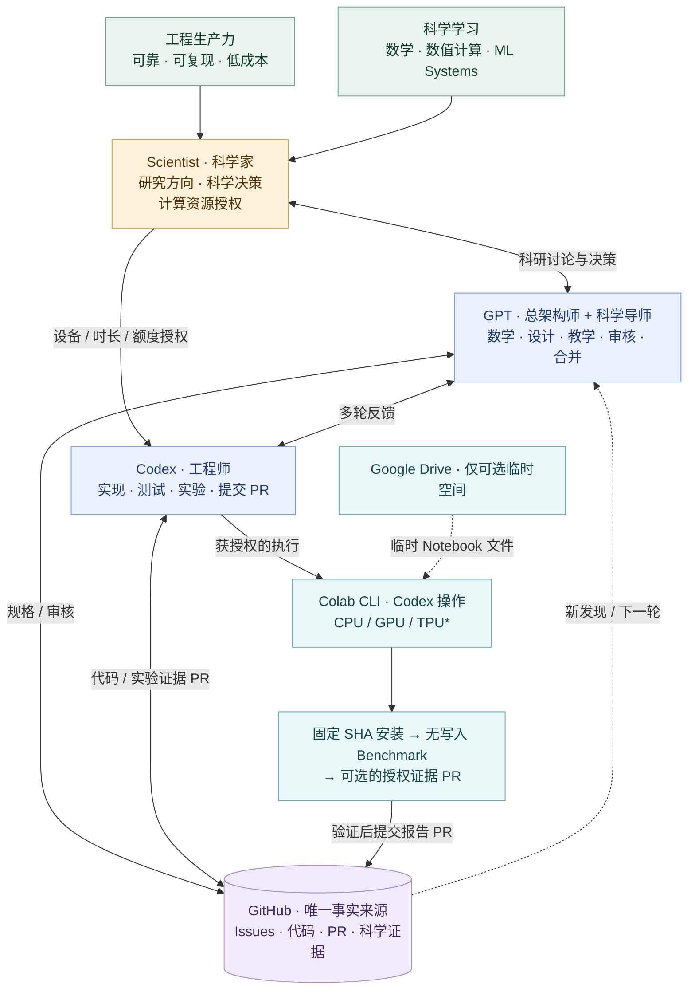

# SAE Framework V3.3

> [English](README.md) 为规范版本 | 简体中文

**Scientist–Architect–Engineer** 是面向数学算法、PyTorch 科学计算和 ML 工程的 GitHub-first 多 Agent 协作框架。两个**同等重要**的目标：**工程生产力**（可靠、可复现、低成本）与**科学学习**（数学、数值计算、PyTorch 和异构计算能力）。

*由 GitHub 原生渲染的可编辑 Mermaid 图；TPU/PyTorch-XLA 与自动发布仍须实测。*

## 角色
- **Scientist（人类）：** 决定研究方向、数学/科学结论，预先批准计算设备、会话、时长与额度；不再日常手动操作 Notebook。
- **GPT Architect：** 设计数学/工程规格与实验，派发 Issue，审核证据，依[常设授权](governance/STANDING_AUTHORIZATION.md)独立决定合格 PR 的合并。
- **GPT Mentor：** 研究数学结构、张量化与数值方法，指导科研学习。
- **Codex Engineer：** 实现、测试并执行获授权的本地 CPU 和 Colab CLI CPU/GPU/TPU 实验，校验结果、释放资源，经 GitHub 分支/PR 提交证据；不自合并。

**GitHub** 是任务、代码与证据中心；**Colab CLI** 提供远程计算；**Drive** 只作可选轻量 Notebook 工作空间，不同步实验结果。

## 工作模式
Scientist 审核[数学结构研究](workflows/MATHEMATICAL_RESEARCH.md) → Architect [生态复用评估](workflows/ECOSYSTEM_REVIEW.md)和派单 → Codex 实现、数值测试、获授权实验 → GitHub 证据 PR → Architect 审核、迭代或合并。可以多轮返回数学研究，不是固定单向流水线。

实验保留**三个独立阶段**：固定源码 SHA 安装、**不写 GitHub** 的 Benchmark、可选且另行授权的安全报告发布。详见[计算实验协议](workflows/GPU_EXPERIMENT.md)和[保留历史文件名的兼容入口](workflows/COLAB_TWO_COMMAND.md)。

## 快速开始
阅读[共同宪章](i18n/zh-CN/AGENTS.zh-CN.md)与[初始化协议 V3.3](i18n/zh-CN/SAE_BOOTSTRAP.md)。采用[项目 AGENTS](examples/project/AGENTS.md)、[sae.yaml](examples/project/sae.yaml)，固定到**真实不可变 SAE commit SHA**；旧项目不自动升级。

| 口令 | 用途 |
| --- | --- |
| `推进导师工作` | 数学研究、科学学习 |
| `推进架构师工作` | 设计、派单、审核、决定合并 |
| `推进工程师工作` | 实现、获授权实验、提交 PR 证据 |

口令是用户触发的有边界工作周期，不代表后台自主服务。不默认使用 GitHub Actions/付费 CI、不泄密、不虚报实验、不通过 Drive 同步结果。

## 验证状态（2026-10-19）
据 Scientist 交接，Codex → WSL2 → Colab CLI 已完成 T4 GPU smoke test、结果完整性验证和会话释放。**尚未验证：** Colab CPU、TPU 分配/PyTorch-XLA、GitHub 自动发布、跨项目复用、完整 SAE Benchmark→PR 链路。文档本身不代表 Bootstrap/Publisher 已实现。

## 文档
[架构师](i18n/zh-CN/protocols/ARCHITECT.md) · [工程师](i18n/zh-CN/protocols/ENGINEER.md) · [导师](i18n/zh-CN/protocols/MENTOR.md) · [科学家](i18n/zh-CN/protocols/SCIENTIST.md) · [角色恢复](i18n/zh-CN/workflows/ROLE_RECOVERY.md) · [变更记录](i18n/zh-CN/CHANGELOG.md) · [中文导航](i18n/zh-CN/README.md)

**版本：** V3.3 文档迁移中；已固定的 V3.2 项目快照须经审查后主动升级。**许可：** 仓库尚未选定 License，公开可见不代表可以任意再利用。
