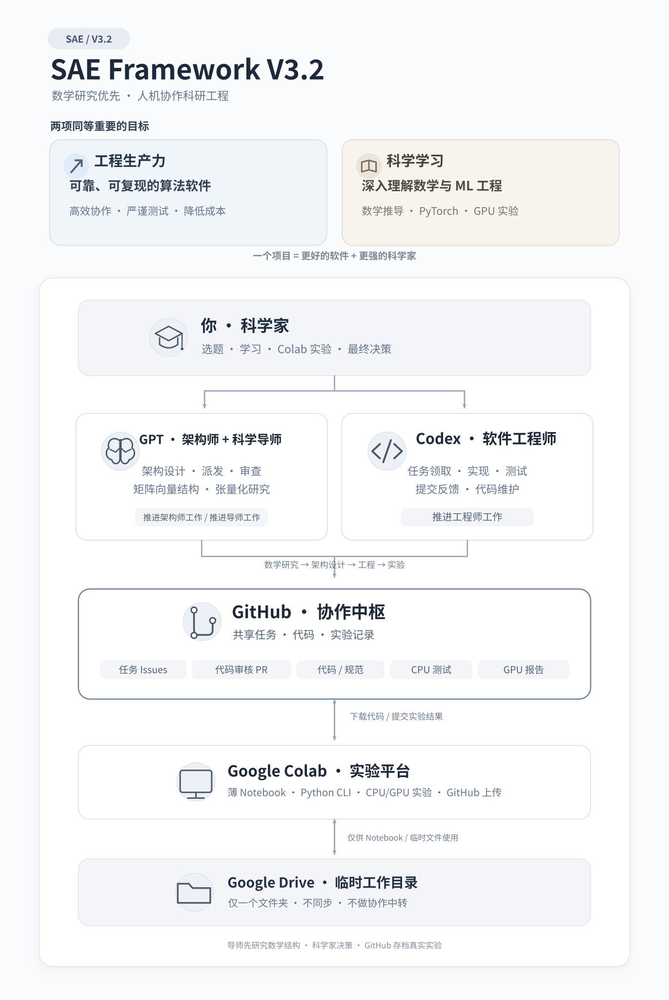

# SAE Framework V3.2

> 语言： [English](README.md) | **简体中文**

**Scientist–Architect–Engineer（SAE）框架**：面向数学算法、PyTorch 科学计算与机器学习工程的 GitHub-first、可复用人机协作组织协议。

> **一个项目，两项成果：更好的软件，更强的科学家。**

## 可视化架构

[下载中文 SVG](docs/figures/SAE_Framework_V3.2.zh-CN.svg) · [英文 SVG](docs/figures/SAE_Framework_V3.2.en.svg) · [中文 Mermaid 架构](i18n/zh-CN/docs/ARCHITECTURE.md)

## 研究先于工程：算法张量化探索

对于每个新算法或重大的张量化重构，GPT 首先以 **Scientific Mentor（科学导师）** 身份展开**数学结构探索**：寻找矩阵—向量积、matrix-free 线性算子、批处理、张量缩并、稀疏/低秩等性质，推导数学等价的张量表达，并研究数值稳定性和跨 CPU/GPU/TPU 可移植性的潜力。

**数学结构探索 → 张量化数学重构 → 架构与实验设计 → Codex 工程与 CPU 验证 → 科学家 Colab 硬件实验 → 反馈迭代**

完成 [张量化研究报告与前置关口](i18n/zh-CN/workflows/MATHEMATICAL_RESEARCH.md) 并经科学家审核后，GPT 再切换总架构师角色进行任务设计。这一顺序避免盲目重写代码；实验反馈可以随时回到数学研究。

## 三份正式研发文档

每个算法项目遵循 [数学 → 工程 → 实验三文档交接协议](i18n/zh-CN/workflows/THREE_ARTIFACT_HANDOFF.md)，不是再增加三个 Agent 或繁琐日报。

| 目标项目文档 | 主要负责人 | 核心问题 |
| --- | --- | --- |
| [数学文档](i18n/zh-CN/templates/TENSORIZATION_STUDY.md) · `docs/research/<algorithm>-tensorization.md` | GPT 导师 + 科学家 | 什么数学结构存在，张量等价变换是否成立？ |
| [工程文档](i18n/zh-CN/templates/ENGINEERING_REPORT.md) · `docs/engineering/<algorithm>-engineering.md` | GPT 架构师 + Codex | 具体实现了什么，CPU 正确性如何真实验证？ |
| [实验文档](i18n/zh-CN/templates/EXPERIMENT_REPORT.md) · `reports/gpu/<run-id>/summary.md` | 科学家 + GPT 解读 | 在真实设备上到底测得了什么结果？ |

数学和工程文档随重要里程碑更新；实验报告只有在实际运行后按独立 run-id 归档。通过 GitHub Issue/PR 与被测源码 SHA 关联，不重复复制实验数据。

## 两项同等重要的目标

| 工程生产力 Engineering Productivity | 科学学习 Scientific Learning |
| --- | --- |
| 用尽可能少的协调和计算成本，构建**可靠、模块化、可复现**的 PyTorch/科学计算算法包。 | 在真实项目中深入理解数学算法、数值计算、PyTorch、GPU 实验与 ML 工程。 |

一次成功的迭代，既要有**可核查的工程证据**，也要有**值得积累的知识与理解**。

## 角色分工

| 角色 | 责任 |
| --- | --- |
| **你：Scientist（科学家）** | 选择研究问题；做最终科学决策；配置并运行 Colab 实验；判断实验结果。 |
| **GPT：Chief Architect（总架构师）** | 数学形式化、算法规格、任务拆解/派发、PR 审查、技术验收，以及得到授权后的合并。 |
| **GPT：Scientific Mentor（科学导师）** | 教授数学原理、算法推导、数值稳定性、PyTorch 与 GPU 测量，并引导独立思考。 |
| **Codex：Software Engineer（工程师）** | 通过 GitHub 领取任务，实现 Python/CLI、运行真实 CPU 测试与 Benchmark、维护代码、提交 PR。 |
| **GitHub：协作中枢** | 统一记录规范、Issues、PR、代码版本、决策和轻量 GPU 实验报告。 |
| **Colab + 最小 Drive 文件夹** | 由科学家操作 CPU/GPU；Drive 只提供 Notebook/临时工作空间，不参与同步或实验结果交换。 |

## 快速开始

1. 阅读 [中文版初始化协议](i18n/zh-CN/SAE_BOOTSTRAP.md)；实际执行时以仓库根目录的 [SAE_BOOTSTRAP.md](SAE_BOOTSTRAP.md) 为规范原文。
2. 阅读 [中文版共同规则](i18n/zh-CN/AGENTS.zh-CN.md) 与根目录规范版 [AGENTS.md](AGENTS.md)。
3. 按角色阅读 [中文协议](i18n/zh-CN/protocols/) 和 [中文流程](i18n/zh-CN/workflows/)。
4. 在新算法项目中复制 [项目 AGENTS 模板](examples/project/AGENTS.md) 与 [sae.yaml 配置示例](examples/project/sae.yaml)，将**固定 Git commit 版本**的框架规则放在项目 `.sae/`。
5. 确认 GPT 和 Codex 真正拥有 GitHub 读取/写入工具权限。**写在文件中的链接不会自动触发跨仓库读取。**

## 三条操作指令

| 指令 | 执行角色 | 一个工作周期 |
| --- | --- | --- |
| **推进架构师工作** | GPT | 检查 GitHub → 数学/技术设计 → 创建/派发 Issue → 审查代码和 Colab 结果 → 授权验收/合并 → 汇报。 |
| **推进工程师工作** | Codex | 领取 Issue → 实现模块 → CPU 测试与 Benchmark → 提交/更新 PR → 反馈。 |
| **推进导师工作** | GPT | **工程之前**探索矩阵向量等数学结构、推导张量化方案并提交研究报告；**工程之后**讲解算法、实验与性能结果。 |

这三条是**协议定义的指令**，不是内置后台常驻 Agent；需要用户触发、实际访问工具以及权限。

## 关键约束

- **GitHub-first：** Issues 是任务队列；PR 是交付和审查通道；Colab 的轻量实验结果也通过 GitHub PR 共享。
- **不使用 GitHub Actions/付费 CI：** Codex 在执行环境中做 CPU 测试，科学家在 Colab 中做 GPU 测试，不伪造 CI 结果。
- **薄 Notebook：** GPT 设计 Notebook 调度；Codex 开发并验证计算模块、CLI、测试和上传器。
- **证据优先：** 保存被测源码 SHA、环境、命令、随机种子、精度、计时方法与报告链接；未执行的测试必须写 NOT RUN。
- **权限和审查分离：** 不擅自 force-push、泄漏密钥、跳过审查或进行破坏性操作。
- **Google Drive 不同步：** 只保留一个简单的 Colab Notebook/临时文件目录。
- **学习也是成果：** 重要里程碑可以留下简短学习笔记，但不强迫每次对话都写报告。

## 文档导航

- [初始化协议](i18n/zh-CN/SAE_BOOTSTRAP.md) · [共同规则](i18n/zh-CN/AGENTS.zh-CN.md)
- [角色协议](i18n/zh-CN/protocols/) · [工作流程](i18n/zh-CN/workflows/)
- [架构说明](i18n/zh-CN/docs/ARCHITECTURE.md) · [工具集成](i18n/zh-CN/docs/INTEGRATIONS.md) · [路线图](i18n/zh-CN/docs/ROADMAP.md)
- [任务和报告模板](i18n/zh-CN/templates/) · [新项目示例](examples/project/sae.yaml)
- [英文原版文档](README.md)

## 当前实现状态

本仓库提供**组织规则、角色协议、项目初始化说明与模板**，不是已部署的自主运行系统。GitHub 写入需要授权工具；Colab Publisher 和自动初始化 CLI 需要 Codex 实现、测试、验收。尚未实现时应手动上传报告，不得宣称自动发布成功。

## 版本与许可

当前架构版本 **V3.2**。项目应使用真实 tag 或 **不可变 commit SHA** 固定协议版本；升级需要审查。参见 [中文变更记录](i18n/zh-CN/CHANGELOG.md)。

仓库尚未选择许可协议。**公开可见不代表允许任意复制或重新发布**；要对外作为模板授权，应由所有者另行决定 License。

**翻译说明：** 根目录英文协议、键名、CLI 和原始任务指令是机器可执行规范；中文是同步维护的阅读版本。如内容出现差异，以英文规范及用户明确授权为准，并创建 Issue 修正翻译。