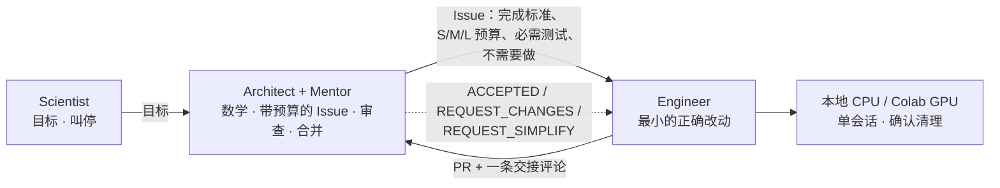

# SAE Framework

> [English](README.md)（规范版本）| 简体中文

**Scientist–Architect–Engineer** 是一套以 GitHub 为中心、让一位人类和几个 AI Agent 协作开发数学 / PyTorch 科研软件的方法。两个同等重要的目标：**以低成本产出正确、可复现的软件**，以及**让 Scientist 更深入地理解**背后的数学、数值方法和硬件行为。

**当前版本：V3.4。** 核心规则是[简洁契约](i18n/zh-CN/governance/SIMPLICITY_CONTRACT.md)：*满足完成标准的最小改动，就是正确的改动。*

## 角色

| 角色 | 默认由谁担任 | 负责 | 从不 |
|---|---|---|---|
| **Scientist** | 你（人类） | 设定目标、调整方向、随时叫停 | 日常审批科研、算力或合并 |
| **Architect + Mentor** | Claude | 数学研究、规格、带预算派活、审查证据、合并 | 自己写生产代码再自己认证 |
| **Engineer** | Codex（或 Claude Code） | 实现、测试、跑 CPU/GPU 实验、开 PR | 审批或合并自己的工作 |

角色是契约而不是产品，任何有能力的 Agent 都可以担任。口令：`推进架构师工作` · `推进导师工作` · `推进工程师工作`。

## 工作流程
1. **Architect** 写一个 Issue，写明：
   - 目标和数学契约；
   - 完成标准；
   - 规模预算（S ≤ 50 / M ≤ 200 / L ≤ 500 行）；
   - 必需测试；
   - "不需要做"清单。
2. **Engineer** 做最小的正确改动，运行必需测试（需要时跑 GPU），开一个 PR，附一条交接评论。
3. **Architect** 先审规模，再审正确性，给出 `ACCEPTED`、`REQUEST_CHANGES` 或 `REQUEST_SIMPLIFY`。符合条件的 PR 按[常设授权](i18n/zh-CN/governance/STANDING_AUTHORIZATION.md)合并。

GitHub Issue 和 PR 是唯一的共享记录。不用 GitHub Actions；计算在 Engineer 本机和现有 Colab 权益上进行。

## 仓库地图

| 路径 | 内容 |
|---|---|
| [AGENTS.md](i18n/zh-CN/AGENTS.zh-CN.md) | 每个 Agent 最先读的宪章 |
| governance/ | [简洁契约](i18n/zh-CN/governance/SIMPLICITY_CONTRACT.md) · [常设授权](i18n/zh-CN/governance/STANDING_AUTHORIZATION.md)（合并范围、安全、支出） |
| protocols/ | 每个角色一页：[Scientist](i18n/zh-CN/protocols/SCIENTIST.md) · [Architect](i18n/zh-CN/protocols/ARCHITECT.md) · [Mentor](i18n/zh-CN/protocols/MENTOR.md) · [Engineer](i18n/zh-CN/protocols/ENGINEER.md) |
| workflows/ | [启动](i18n/zh-CN/workflows/START.md)（新会话、项目采用）· [任务](i18n/zh-CN/workflows/TASKS.md)（Issue、PR、审查）· [研究](i18n/zh-CN/workflows/RESEARCH.md)（数学、复用、学习）· [计算](i18n/zh-CN/workflows/COMPUTE.md)（CPU/GPU 运行） |
| templates/ | Issue、PR、研究笔记、运行摘要 |
| [tools/compute/](tools/compute/README.zh-CN.md) | Colab 控制器：有界单 GPU 会话、实际设备观测、保证清理 |
| [examples/](examples/) | 项目 `AGENTS.md`、`sae.yaml`、`.sae/README.md` 和计算适配器 |

英文为规范版本，中文译本位于 `i18n/zh-CN/`，修改规则时须在同一 PR 内同步。

## 开始
- **新会话：** 见[启动](i18n/zh-CN/workflows/START.md)，里面有 Architect 和 Engineer 窗口可直接粘贴的启动口令。
- **新项目：** 复制 [examples/project](examples/project/) 下的文件，固定一个精确的 SAE commit SHA，然后开 PR（[启动 § 在项目中采用 SAE](i18n/zh-CN/workflows/START.md#在项目中采用-sae)）。
- **已有项目**在主动升级固定版本之前，一直使用原来的 SAE commit。

## 状态
- **已验证：** Colab 控制器在真实 T4、L4、A100 和 G4（RTX PRO 6000）上运行，记录了实际设备并完成认证清零（[#67](https://github.com/JohnnyZPiggy/SAE-Framework/pull/67)、[#69](https://github.com/JohnnyZPiggy/SAE-Framework/pull/69)、[#73](https://github.com/JohnnyZPiggy/SAE-Framework/pull/73)）。第一个项目：[TorchOED](https://github.com/JohnnyZPiggy/TorchOED)。
- **未实现：** TPU / PyTorch-XLA、自动项目初始化、任何后台调度器。

[变更记录](i18n/zh-CN/CHANGELOG.md) · [MIT License](LICENSE) © 2026 JohnnyZPiggy
