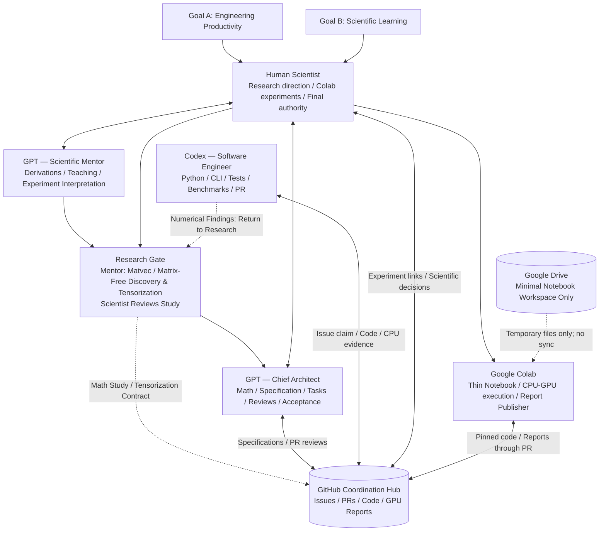

# SAE V3.2 Architecture and Boundaries

> Language: **English** | [简体中文](../i18n/zh-CN/docs/ARCHITECTURE.md)

> **One Project, Two Outcomes: Better Software, Better Scientist.**

See the [high-resolution visual architecture](figures/SAE_Framework_V3.2.en.svg) embedded at the top of the [project README](../README.md). The Mermaid chart below is the text-editable equivalent.

## Parallel success criteria
**Engineering Productivity:** working, documented, maintainable Python packages; accurate CPU and GPU numerics; reproducible performance; low labor/token/compute cost.

**Scientific Learning:** Scientist can explain the underlying mathematical assumptions, algorithm, trade-offs, PyTorch strategy and observed GPU behavior; meaningful notes/exercises from each milestone.

## Research-first operating principle

1. **Mentor mathematical discovery:** reconstruct algorithm mathematics and find matvec, matrix-free, contractions, separable/batched/low-rank operators and true parallelism; identify sequential barriers.
2. **Mentor tensorization research:** derive equivalent tensor/matrix expressions and shape contracts; assess numerical correctness, memory/complexity and CPU/GPU/TPU feasibility.
3. **Scientist research gate:** review `RESEARCH_READY`, `RESEARCH_BLOCKED` or `NOT_TENSORIZABLE`, with mathematical study and alternatives.
4. **Architect design:** convert approved derivation into algorithms, modules, acceptance tests and Colab experiment plan.
5. **Codex engineer:** implement/test CPU reference and tensor formulation via Issue/PR.
6. **Scientist Colab experiments:** evaluate pinned code, report accuracy and real hardware measurements to GitHub; Mentor/Architect can revisit step 1 or 2.

The research gate precedes formal engineering and acceleration experiments, but the R&D loop remains **iterative**, not a one-way waterfall. See [mathematical research workflow](../workflows/MATHEMATICAL_RESEARCH.md).

## System diagram (GitHub-rendered Mermaid)

## GitHub protocol, not agent magic
A role protocol is an explicit, versioned **instruction**. It is **not** an always-running process; agents must be prompted, have suitable tools, be authorized, and actually fetch the necessary file contents.

The Framework repository is a library of organization rules. Each implementation repository holds an **immutable/pinned local snapshot** plus project-specific AGENTS and config. Codex's in-repo rules do not automatically fetch another repository; GPT likewise needs explicit reads.

## Three linked scientific artifacts

For each algorithm, the Mentor/Scientist **Mathematical Research**, Architect/Codex **Engineering Report**, and Scientist-run **Experimental Report** form a traceable evidence chain. GitHub Issues/PRs record workflow status; artifacts carry equations, implementation evidence and measured results, linked by the correct source SHA. Do not introduce agent-specific daily reports. Read [Three-Artifact Handoff](../workflows/THREE_ARTIFACT_HANDOFF.md) and the [math](../templates/TENSORIZATION_STUDY.md), [engineering](../templates/ENGINEERING_REPORT.md), and [experiment](../templates/EXPERIMENT_REPORT.md) templates.

## Shared state
| State | Canonical location |
| --- | --- |
| Scientific problem / math contract | `docs/` and GitHub Issues |
| Work queue / engineer claims | GitHub Issues |
| Source implementation / review | Git branches + PRs |
| CPU numerical and regression evidence | PR body / test logs / compact attachments |
| GPU correctness / benchmark evidence | versioned report directory via experiment PR and Issue link |
| Learning outcomes | milestone learning notes or Issue/PR comment |
| Large transient experimental data | Colab runtime / optional personal Drive folder, linked if appropriate; no Drive sync |

## Default boundaries
No GitHub Actions or hosted CI; no automatic merge by Engineer; no fabricated tests; no private credentials in a public repository; no direct experiment push to protected main; no changes to an existing repository without a diff/review plan.

## Lifecycle
Idea → Mentor + Scientist mathematical study/approval → Architect design → `agent:codex` Issue → Engineer claim/implementation/CPU testing → PR → Architect review → Scientist Colab GPU validation if required → experiment report PR → Architect acceptance → authorized merge → Mentor consolidation. Re-enter the loop wherever a real blocker or new result appears. This is iterative, **not a rigid linear pipeline**.

**Current three-step Colab contract:** The Scientist installs a pinned SHA, runs an independent correctness/benchmark CLI without GitHub writes, then optionally publishes reviewed small reports using `GITHUB_TOKEN`. The separate Publisher is a target until implemented and tested; see [GPU Experiment](../workflows/GPU_EXPERIMENT.md).
