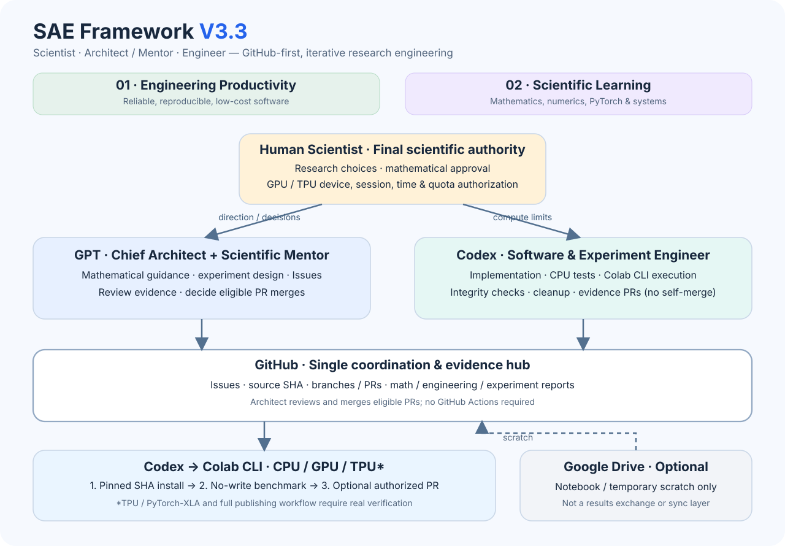
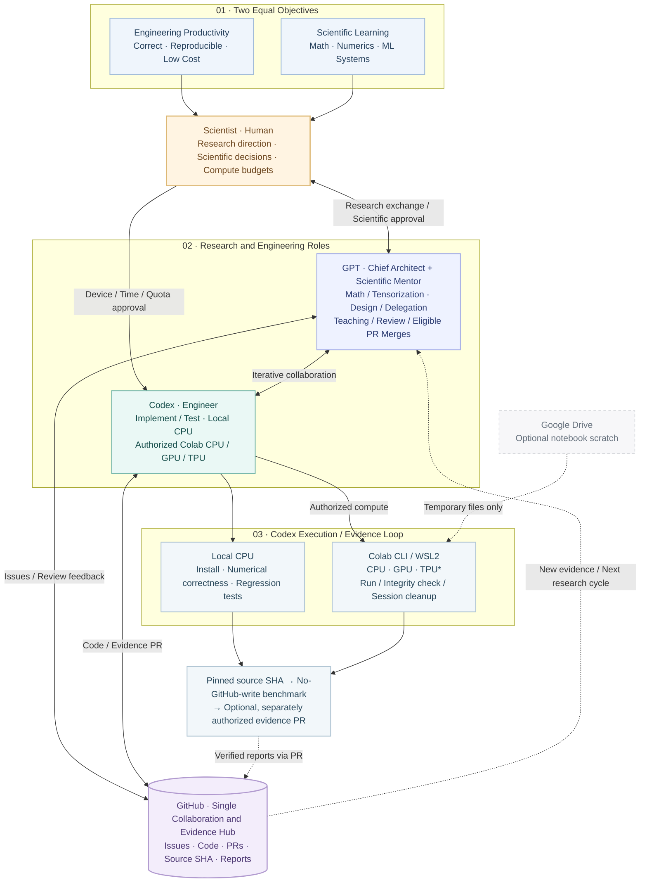

# SAE V3.3 Architecture and Boundaries

> English normative | [简体中文](../i18n/zh-CN/docs/ARCHITECTURE.md)

[View high-resolution vector SVG](figures/SAE_Framework_V3.3.en.svg)

[Editable Mermaid source (.mmd)](figures/SAE_Framework_V3.3.en.mmd)

Show editable Mermaid architecture diagram

The standalone SVG is the designed native-card presentation of V3.3; the collapsible Mermaid remains the editable logical diagram. Both preserve role authority and experiment verification boundaries. Keep bilingual SVGs and Mermaid counterparts synchronized when architecture rules change.

[Current role contracts](../AGENTS.md)

## Two equal outcomes
**Engineering Productivity:** reproducible, correct, maintainable algorithm packages at low coordination and compute cost.

**Scientific Learning:** deepen the Scientist's understanding of mathematical structure, numerical methods, PyTorch, device execution and performance interpretation.

## Authority and execution
- **Scientist:** chooses research direction, approves mathematical/scientific decisions and authorizes GPU/TPU device, session/time/quota budgets. Not the routine Colab operator.
- **GPT Architect + Mentor:** explores mathematics and tensorization, designs interfaces/experiments, assigns GitHub Issues, reviews real evidence, mentors the Scientist and decides eligible PR merges under [Standing Authorization](../governance/STANDING_AUTHORIZATION.md).
- **Codex Engineer:** writes and tests code, runs local CPU and authorized Colab CLI CPU/GPU/TPU experiments, verifies downloaded artifacts and resource cleanup, opens evidence PRs; never self-merges.
- **GitHub:** only durable task and evidence hub (Issues, PRs, source SHAs and the three linked scientific reports).
- **Colab CLI:** compute execution surface, not the report exchange layer. Google Drive is optional temporary notebook scratch, not synchronization.

## Iterative operating loop
Scientist-approved mathematical research → Architect design and Build-vs-Reuse review → Codex implementation/CPU correctness → Architect readiness review → authorized Codex device experiments → GitHub evidence PR → Architect review/eligible merge → Mentor interpretation. Numerical or mathematical failures return to earlier stages; this is not a linear waterfall.

Experiments separate **(1)** exact SHA installation, **(2)** correctness/benchmark without GitHub writes, **(3)** optional separately authorized and validated report branch/PR publication. TPU requires separately verified PyTorch/XLA support. No GitHub Actions or mandatory paid CI.

## Evidence and capability honesty
A 2026-10-19 handoff reports Windows Codex → WSL2 → Colab CLI → T4 GPU smoke test, SHA-256 checking and runtime cleanup. Colab CPU, TPU/PyTorch-XLA, automated GitHub publication and full cross-project workflow remain **NOT VERIFIED** until actual tests establish them.

See [Research Pipeline](../workflows/RESEARCH_PIPELINE.md), [Three Artifacts](../workflows/THREE_ARTIFACT_HANDOFF.md) and [Compute Experiments](../workflows/GPU_EXPERIMENT.md). Existing pinned project snapshots do not upgrade automatically.
