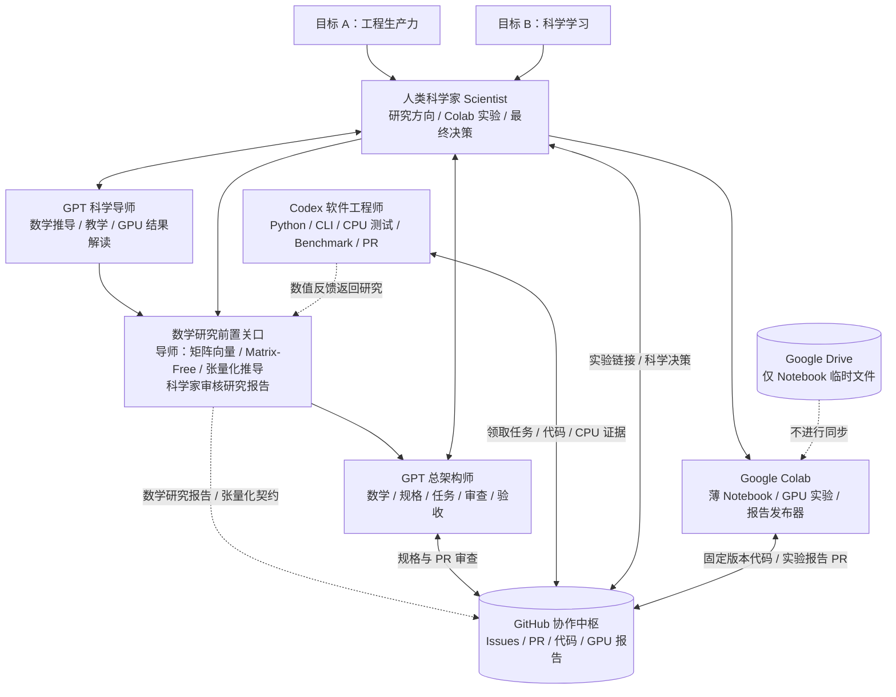

# SAE V3.2：组织架构与角色边界

> 语言：[English](../../../docs/ARCHITECTURE.md) | **简体中文**

> **一个项目，两项成果：更好的软件，更强的科学家。**

[查看中文版高清 SVG 架构图](../../../docs/figures/SAE_Framework_V3.2.zh-CN.svg) · [返回中文首页](../../../README.zh-CN.md)

## 两个并行评价维度
**工程生产力：** 可运行、可维护的 Python 软件，可靠的 CPU/GPU 数值，真实可复现的性能，低成本与低协调开销。

**科学学习：** 科学家能够解释原始数学问题、算法假设、复杂度、数值方法、PyTorch 重构和所观察到的 GPU 行为，积累重点心得。

## 研究先于工程的组织原则

1. **GPT 导师探索数学结构：** 研究原算法，寻找矩阵向量、matrix-free、缩并、低秩、批量化等算子，识别不能并行的环节。
2. **GPT 导师推导张量数学重构：** 在代码之前证明/阐明等价表达、维度和约束，分析精度、复杂度及 CPU/GPU/TPU 可行性。
3. **科学家审查研究结论：** `RESEARCH_READY` / `RESEARCH_BLOCKED` / `NOT_TENSORIZABLE`。
4. **GPT 架构师设计：** 基于获认可的数学推导完成算法模块、验收标准和实验方案。
5. **Codex 工程实现：** 开发 CPU 参考/张量版本，进行真实 CPU 测试，提交 PR。
6. **科学家 Colab 实验：** 在固定源码 SHA 上验证精度与硬件性能，发现问题可回到第一或第二步。

这是**正式工程及加速实验之前**的研究关口，而非不可回退的瀑布模型。见 [数学研究协议](../workflows/MATHEMATICAL_RESEARCH.md)。

## Mermaid 组织架构（GitHub 可直接渲染）

## 这是协议，不是魔法
角色协议是版本化的**执行说明**，并非后台常驻服务。智能体必须被触发、拥有对应权限，并真正读取文件内容。母仓库保存组织规则；子项目应安装**固定版本的本地协议副本**及项目 AGENTS/config。Codex 不会因为看到另一个仓库 URL 就自动载入；GPT 也需明确读取。

## 信息归属
| 信息 | 权威位置 |
| --- | --- |
| 科学问题和数学契约 | `docs/`、GitHub Issues |
| 任务队列与领取状态 | GitHub Issues |
| 代码实现与审查 | 分支与 PR |
| CPU 正确性/回归证据 | PR 正文、测试日志、简洁附件 |
| GPU 正确性/性能证据 | 版本化报告目录、实验 PR、Issue 链接 |
| 学习成果 | 里程碑学习笔记或 Issue/PR 评论 |
| 大型临时实验数据 | Colab 运行环境 / 可选个人 Drive 临时目录；不做同步 |

## 默认权限边界
不使用 GitHub Actions/付费 CI；Codex 不得自动合并；不捏造测试；不能把私人凭证放在公共仓库；实验报告不直接推送受保护 `main`；修改旧项目之前先评估差异。

## 多轮研发闭环
科学问题 → GPT 数学规格 → `agent:codex` Issue → Codex 领取/实现/CPU 验证 → PR → GPT 审查 → 科学家 Colab GPU 验证（按需）→ 实验报告 PR → GPT 验收/授权合并 → GPT 导师总结。新结果或阻塞可以让任意阶段回到之前步骤，**并非固定线性流水线**。