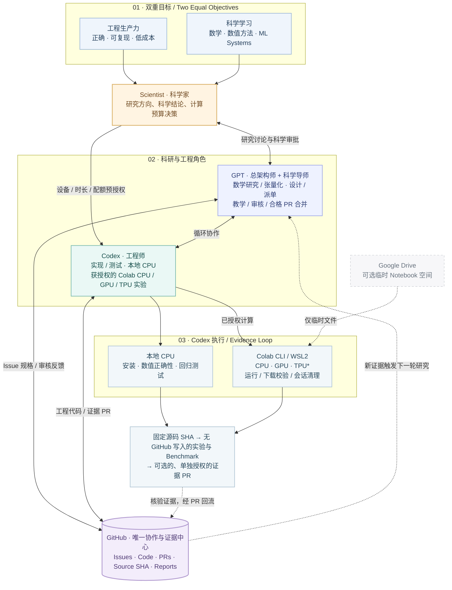

# SAE V3.3 架构与边界

> [English](../../../docs/ARCHITECTURE.md) 为规范版本 | 简体中文说明

[可编辑 Mermaid 源码 (.mmd)](../../../docs/figures/SAE_Framework_V3.3.zh-CN.mmd)

展开可编辑的 Mermaid 架构图

SVG 矢量图与 Mermaid 源码共同描述 V3.3 的角色分工和实验闭环；架构变化时应同步维护。

## 两个同等重要的目标
**工程生产力：** 以低协调与计算成本构建正确、可复现、可维护的算法包。  
**科学学习：** 深化 Scientist 对数学结构、数值方法、PyTorch、异构计算与性能结果的理解。

## 职责
- **Scientist：** 决定研究方向、数学/科研结论，事先授权 GPU/TPU 的硬件、会话、时长与额度；不再日常手动运行 Colab。
- **GPT Architect + Mentor：** 数学指导、规格/实验设计、GitHub 派单、证据审核；依据[常设授权](../../../governance/STANDING_AUTHORIZATION.md)决定合格 PR 合并。
- **Codex Engineer：** 实现和测试，执行本地 CPU 与获授权的 Colab CLI CPU/GPU/TPU 实验，校验下载结果、释放会话、提交证据 PR；不得自合并。
- **GitHub：** 唯一长期任务与证据中心（Issues、PR、源码 SHA、数学/工程/实验报告）。
- **Colab CLI：** 计算执行端；Google Drive 仅可选 Notebook 临时空间，不是结果同步渠道。

## 多轮循环
Scientist 审核数学研究 → GPT 设计并评估复用 → Codex 工程/CPU 测试 → GPT 审核实验准备 → Codex 获授权的设备实验 → GitHub 证据 PR → GPT 审核/合并与导师讲解。失败可以回到数学或工程阶段，并非单向流水线。

实验分为 **固定 SHA 安装 → 不写 GitHub 的正确性/Benchmark → 可选、单独授权的安全报告 PR** 三个阶段。TPU/PyTorch-XLA 需单独实测，不使用 GitHub Actions 或强制付费 CI。

## 已验证与未验证
据 2026-10-19 交接，Windows Codex 经 WSL2/Colab CLI 完成 T4 GPU smoke test、SHA-256 校验和会话清理。Colab CPU、TPU/PyTorch-XLA、GitHub 自动发布和跨项目闭环仍属 **NOT VERIFIED**。

参见[研发流程](../../../workflows/RESEARCH_PIPELINE.md)、[三文档交接](../../../workflows/THREE_ARTIFACT_HANDOFF.md)和[计算实验](../../../workflows/GPU_EXPERIMENT.md)。旧项目固定快照不会自动升级。
